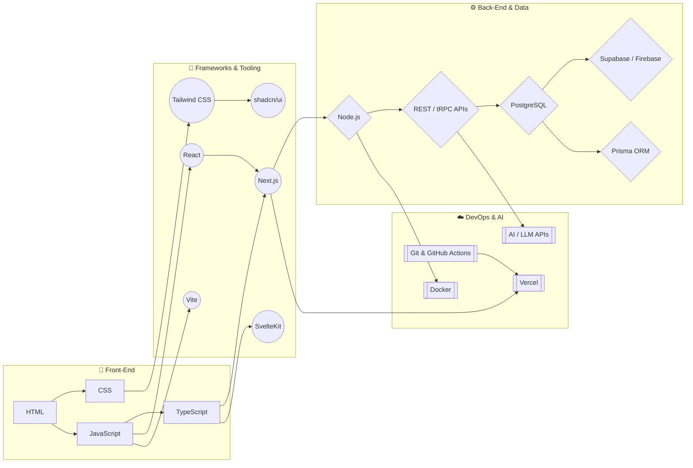

<!-- ============================  HEADER  ============================ -->

  

  

  
  
  
  
  

##  About Me

I'm a **Front-End / Full-Stack Web Developer from Ghana 🇬🇭** who loves turning ideas into fast, accessible, good-looking products on the web.

Watching technology 🌐 reshape everyday life in ways nobody predicted is what pulled me into web and app development — and that curiosity has only grown since. I enjoy exploring new tech stacks 💻 and using them to build things people actually use 🛠️.

- 🔭 Currently building an **Attendance Booking System**
- 🌱 Currently learning **UI/UX design, software engineering & system design, and AI-powered app development**
- 🤖 Exploring **AI integrations** (LLM APIs, chatbots, RAG) in real-world web apps
- 👯 Looking to collaborate on **open-source and full-stack projects**
- 🤝 Looking for help with **my projects & sponsors**
- 💼 Open to **freelance, internships and full-time roles**
- 📫 Reach me at **phleodelly@gmail.com**
- ⚡ Fun fact: **I'm a sociable, open person — say hi!**

 

## 🚀 Featured Projects

| Project | Description | Stack |
|---|---|---|
| 🗓️ **Attendance Booking System** *(in progress)* | Book, track and manage attendance with role-based dashboards | Next.js · TypeScript · PostgreSQL · Tailwind |
| 🌐 **[Personal Portfolio](https://felix-ashong.vercel.app/)** | My projects, skills and experience in one place | Next.js · Tailwind CSS · Vercel |

  
  
  
  

> 👉 More on my [portfolio](https://felix-ashong.vercel.app/) and in my [repositories](https://github.com/FelixAshong?tab=repositories).

## 🧭 Learning Pathway

##  Tech Stack

**Languages**

  

**Front-End & Frameworks**

  

**Back-End & Databases**

  

**DevOps, Cloud & Tools**

  

  
  
  
  
  

 

## 📊 GitHub Stats

  
  

  

  

  

  
<b>🏆 More cards</b>

   
  

    
  

  

    
    
  

  

    
    
  

## 🐍 Contribution Snake

  <picture>
    <source media="(prefers-color-scheme: dark)" srcset="https://raw.githubusercontent.com/FelixAshong/FelixAshong/output/github-snake-dark.svg" />
    <source media="(prefers-color-scheme: light)" srcset="https://raw.githubusercontent.com/FelixAshong/FelixAshong/output/github-snake.svg" />
    
  </picture>

## ✍️ Dev Quote & Joke

  

  

##  Connect With Me

  
  
  
  
  
  
  

## ☕ Support My Work

  

  

